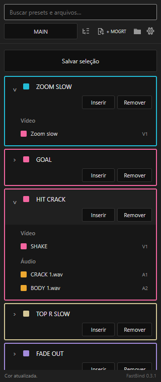

# FastBind

A small, open-source library panel for Adobe Premiere Pro. Save adjustment layers together with audio, then insert the whole package with a double-click. Keep MOGRTs and different libraries in separate profiles.

**Experimental · Premiere Pro 26.3+ · English / Português · MIT**

[Download CCX — Windows & macOS](https://github.com/yleosamp/FastBind/releases/download/v0.4.2/FastBind-0.4.2.ccx) · [Releases](https://github.com/yleosamp/FastBind/releases/latest) · [English](#install) · [Português](#português) · [Changelog](CHANGELOG.md) · [Privacy](docs/PRIVACY.md)



## Install

The update notifier starts with version **0.3.2**. Older versions need this one-time manual download before they can show future release notices.

1. [Download the latest **FastBind `.ccx`**](https://github.com/yleosamp/FastBind/releases/latest). You do not need the source code ZIP.
2. Double-click the `.ccx` and confirm installation in **Adobe Creative Cloud Desktop**.
3. In Premiere, open **Window > UXP Plugins > FastBind**. Menu wording may vary by version and language.

The same CCX package is intended for Windows and macOS. Keep Creative Cloud Desktop installed and up to date. No Node.js, Terminal commands, development tools or manual copying into plugin folders is needed. If Premiere asks to enable Developer Mode for an independently distributed plugin, follow its prompt in Preferences > Plugins. See [Adobe's CCX installation guide](https://developer.adobe.com/premiere-pro/uxp/plugins/distribution/install/).

If a running Premiere still shows an older panel, save your work and restart Premiere when convenient. Updating uses the same plugin identity and does not intentionally reset your library. The legacy `pilha` identifiers are retained for compatibility.

**Platform status:** Windows installation has been checked with Adobe's installer. macOS installation and native Premiere behavior have not been validated on a Mac. This is an experimental, community-distributed plugin, not an Adobe Marketplace listing.

### Updates

FastBind checks GitHub for a newer stable release when the panel opens, with a 24-hour local cache. If one is available, a small update badge appears in the panel. **Settings > Check for updates** checks manually. Offline or failed checks do not block editing.

Clicking the badge opens the release page in your browser, where you can download and install the new `.ccx`. FastBind does **not** download/install updates automatically or restart Premiere. The first browser launch may ask for permission. Release checks send no project, clip or library data; see [Privacy](docs/PRIVACY.md).

## Use

1. Open and save a Premiere project.
2. Select the adjustment layers and audio clips you want to reuse.
3. Choose **Save selection**, name the package and save. This also saves your current Premiere project.
4. Move the playhead to the destination, then double-click the package name or choose **Insert**.

Use **+ MOGRT** to add a template. The profile selector switches libraries and creates new profiles. Expand a package to see its video/audio clips; click its color square to change its color. Search matches both package and clip names.

Drag the **preset name** up/down to reorder. Expand a preset and choose **Move to profile…** to move it without re-saving its contents.

### Sharing profiles (0.4+)

In Settings, choose **Export profile…** to create a `.fastbind` archive. Export saves the current Premiere project, prepares a separate project containing only this profile's library sequences, and collects their media. It does not send the full original project snapshots. MOGRTs and a bilingual `requirements.txt` are included.

Your friend chooses **Import profile…**. Resources are verified and copied into their private plugin library; a new independent profile is committed only after the copies succeed. They can delete the received archive afterward. Same-named profiles are kept separately. Expand an imported preset and choose **View requirements…** to reopen its requirements.

**Initial limits:** 256 MiB for both the archive and expanded files, 32 MiB project XML, 2,048 entries. Media is collected whole, not trimmed. Font/plugin binaries and licenses are not included; install them separately. Only exposed effect/font names can be listed automatically. Opaque effect data and MOGRTs may reference additional resources Premiere does not expose. Dynamic Link, detected image sequences and unrecognized external dependencies stop export rather than producing a knowingly incomplete package. Review third-party media/preset licenses before sharing. Native export/import still needs user acceptance testing in Premiere; automated tests do not prove Adobe's native behavior.

**Remove** archives an item rather than deleting its saved files. Restore it with **Settings > Restore last removed**. Settings also provide **English**, **Português** and **Automatic (Premiere)**. Automatic uses Portuguese for a Portuguese Premiere UI and English otherwise.

The playhead position inside a selection becomes its insertion anchor; if the playhead is outside, the package starts at its earliest selected clip. This is useful for aligning a transition's impact.

## Keep in mind

- FastBind plans video above occupied video tracks and audio below occupied audio tracks across the package's full span. It does not intentionally ripple or overwrite existing clips. Native API failures remain possible: keep project backups and review the result.
- Packages retain native Premiere clips/effects through an internal library sequence and a saved project copy. They are **not** `.prfpset` effect presets applied directly to a selected clip.
- Ordinary saved selections reference the original audio/video files; keep them available. **Export profile** collects recognized media/file dependencies for sharing, subject to the limits above. Fonts and third-party effect binaries are never collected. MOGRT files themselves are copied into the library.
- Unknown native fades/transitions may require confirmation when saving. They cannot always be inspected or reproduced through the available API. Masks, links, easing and third-party effect compatibility are not universally verified.
- Old or unverified insertion records never block another insert or require Undo. After Premiere accepts a transaction, post-insert readback differences remain local diagnostics only, without a red error or retry prompt. An unverified result is not marked verified. Preparation, occupancy and actual native commit errors still report normally; FastBind never undoes or retries automatically.
- Global keyboard shortcuts per package are not implemented. Use Insert or double-click.

The folder button shows the local library location. Back up that **entire folder**, not only its JSON files. Saved project copies and diagnostics may contain private project information; do not upload your library when reporting a bug. See [Privacy](docs/PRIVACY.md).

## Development

Node.js is needed only for development; users do not need npm. The runtime vendors fflate 0.8.2 (MIT) for local archive/gzip processing and has no telemetry. Its only network request checks the public FastBind release metadata on GitHub; no account or token is required.

```sh
npm run check
npm test
```

The test suite covers planning, storage, simulated Premiere integration, recovery, localization and panel events. Optional `tools/preview.cjs` checks the real panel code in an isolated headless browser with a simulated host. These checks do not prove Adobe's native UXP rendering or every Premiere workflow; no production timeline is automated for testing.

Runtime modules: `core.js` (planning), `host.js` (Premiere integration), `library.js` (local storage), `main.js` (panel), `view.js` (presentation), `locale.js` (language), `updates.js` (release notifications), `portable.js` (profile transport), `vendor/fflate.js` (MIT compression library).

## License

FastBind's own code and icons are [MIT licensed](LICENSE). No third-party presets, MOGRTs, media, fonts or commercial effects are included. Their licenses remain with their respective owners. FastBind is independent and is not affiliated with Adobe or other plugin vendors.

## Português

### Instalar

O aviso de atualização começa na versão **0.3.2**. Quem usa uma versão anterior precisa baixar esta atualização manualmente uma vez para receber os próximos avisos.

1. [Baixe o **FastBind `.ccx`** mais recente](https://github.com/yleosamp/FastBind/releases/latest). Não precisa baixar o ZIP do código.
2. Dê dois cliques no `.ccx` e confirme a instalação no **Adobe Creative Cloud Desktop**.
3. No Premiere, abra **Janela > Plugins UXP > FastBind**. O nome do menu pode variar conforme a versão e o idioma.

O mesmo CCX é destinado a Windows e macOS, com Premiere Pro 26.3 ou superior. Não precisa de Node.js, Terminal, ferramentas de desenvolvimento nem copiar arquivos entre pastas. Mantenha o Creative Cloud Desktop instalado e atualizado. Se o Premiere pedir para ativar o Modo de desenvolvedor para um plugin independente, siga a orientação em Preferências > Plugins. Veja o [guia de instalação da Adobe](https://developer.adobe.com/premiere-pro/uxp/plugins/distribution/install/).

**Versão experimental:** a instalação foi conferida no Windows pelo instalador da Adobe. Ainda não houve validação nativa em um Mac. O plugin é distribuído pela comunidade, não pelo Adobe Marketplace.

Se o Premiere já aberto continuar mostrando a versão antiga, salve seu trabalho e reinicie quando for conveniente. A atualização mantém a identidade da instalação para preservar a biblioteca existente.

### Atualizações

Ao abrir o painel, o FastBind consulta se existe uma nova release estável no GitHub, com cache local de 24 horas. Quando houver, aparece um aviso pequeno no painel. A engrenagem também oferece **Verificar atualizações**. Falha de conexão ou uso offline não impedem a edição.

O aviso abre a página da release no navegador quando você clicar. Baixe o novo `.ccx` e instale normalmente. O plugin **não** baixa/instala atualizações nem reinicia o Premiere automaticamente. A primeira abertura do navegador pode pedir permissão. A consulta não envia projetos, clipes ou dados da biblioteca; veja [Privacidade](docs/PRIVACY.md#português).

### Usar

Selecione os adjustment layers e áudios na timeline, clique **Salvar seleção** e dê um nome. Isso também salva o projeto atual. Depois, posicione o playhead e use **Inserir** ou dê dois cliques no nome do pacote.

**+ MOGRT** adiciona templates. O seletor de perfis organiza bibliotecas separadas. A setinha mostra os clipes salvos; o quadradinho muda a cor. A busca encontra nomes de pacotes e de clipes. **Remover** arquiva o item; a engrenagem permite restaurar o último removido e trocar o idioma.

Arraste o **nome do preset** para cima/baixo para ordenar. Abra a setinha e use **Mover para perfil…** para transferir a seleção inteira.

Desde a versão 0.4.0, a engrenagem oferece **Exportar perfil…** e **Importar perfil…**. O arquivo `.fastbind` inclui o projeto separado das seleções, mídias e MOGRTs; na importação tudo é copiado para a biblioteca, permitindo apagar o pacote recebido. Fontes e efeitos externos precisam ser instalados separadamente. A exportação salva o projeto atual e prepara um projeto temporário separado, sem enviar o snapshot inteiro do projeto original.

**Limites iniciais:** 256 MiB para pacote e conteúdo descompactado, XML do projeto até 32 MiB e 2.048 entradas. As mídias vão inteiras. Dynamic Link, sequências de imagens detectadas e dependências de arquivo não reconhecidas interrompem a exportação; não são omitidas silenciosamente. Dados opacos de efeitos/MOGRTs podem exigir recursos adicionais não expostos pelo Premiere. Os requisitos podem ser reabertos na setinha do preset importado. Confira as licenças antes de compartilhar. Os testes automatizados não substituem a validação nativa no Premiere.

O pacote é inserido acima do vídeo ocupado e abaixo do áudio ocupado, sem ripple intencional. Revise o resultado e mantenha backups: nenhuma integração está imune a falhas do Premiere.

Registros antigos ou não verificados não travam mais o próximo insert nem exigem Ctrl+Z. Quando o Premiere aceita a inserção, diferenças na conferência posterior ficam somente no diagnóstico local, sem erro vermelho ou pedido para reinserir. Isso não transforma um resultado não verificado em verificado. As checagens de faixas ocupadas e erros reais de preparação/execução continuam; não há Undo nem repetição automática.

**Importante:** seleções salvas normalmente continuam referenciando as mídias originais. Use a exportação de perfil para coletar mídias compatíveis ao compartilhar; não envie a pasta inteira da biblioteca. Fontes/plugins externos continuam necessários. Não é um importador de presets `.prfpset`. A biblioteca guarda cópias de projetos que podem conter informações privadas. Faça backup da pasta completa mostrada no ícone de pasta e não publique esses arquivos. Leia [Privacidade](docs/PRIVACY.md#português).
